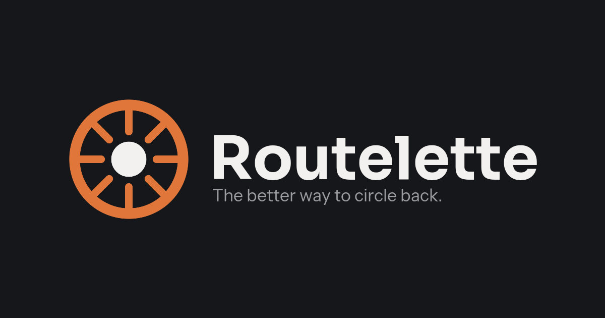

<p align="center">
  
</p>

# Routelette

<p align="center">
  <a href="https://nuxt.com"></a>
  <a href="https://vuejs.org"></a>
  <a href="https://www.typescriptlang.org"></a>
  <a href="https://maplibre.org"></a>
  <a href="https://nodejs.org"></a>
  <a href="https://vitest.dev"></a>
</p>

Routelette is a loop planner for biking, running and walking. Pick a start, a mode and a distance. It finds up to three circular routes that come back to where you began. Don't like em? Roll for another set.

The name is a portmanteau of "route" and "roulette".

The design lives in the [Routelette Figma file](https://www.figma.com/design/AQ4efreQvchgfyRpFU7i2H). The product spec lives in [docs/spec.md](docs/spec.md).

---

## What it does

- **Loops from one start.** Set a start by search, the locate button or a map click. Routes are calculated in a browser worker, not on a server.
- **Three modes.** Bike, run and walk each keep their own distance range, pace and routing preferences.
- **Distance and elevation limits.** Set a distance with the slider or by typing it. Then pick a gain band, or enter your own total.
- **Surface.** Mixed, paved or trail routes.
- **Stops and joints.** Add up to five checkpoints. Drag a point on the selected route to reshape it.
- **Roll.** Pick a new seed for a fresh set of routes.
- **Reverse.** Calculate a legal route in the opposite direction.
- **Saved routes and sharing.** Keep routes on your device and rename them. Send a read-only link to anyone.

## Modes

|                   | Bike                                                                      | Run                                            | Walk             |
| ----------------- | ------------------------------------------------------------------------- | ---------------------------------------------- | ---------------- |
| Default distance  | 15 mi                                                                     | 5 mi                                           | 2 mi             |
| Range             | 5 to 60 mi                                                                | 1 to 26 mi                                     | 0.5 to 10 mi     |
| Slider step       | 1 mi                                                                      | 0.5 mi                                         | 0.25 mi          |
| Default pace      | 5 min/mi (12 mph)                                                         | 9.5 min/mi                                     | 20 min/mi        |
| Allowed ways      | Roads, cycleways and tracks. No steps. Footways only where `bicycle=yes`. | Anything walkable, including trails and paths. | Same as run.     |
| Second preference | Prefer bike lanes                                                         | Prefer sidewalks                               | Prefer sidewalks |

Switching mode regenerates the routes with the same seed and the new mode's settings. The distance carries over when it fits the new range. Otherwise it clamps to the range. Each mode saves its own pace.

## Requirements

- Node.js 24 or later.
- npm.
- About 1 GB of disk space for the four Geofabrik extracts that build the routing graph. The test suite does not need them.

## Getting started

### Install and run

```bash
npm install
npm run dev
```

The dev server listens on `127.0.0.1` at port 3000. `npm install` runs `nuxt prepare` automatically.

### Build the routing graph

Routing reads a graph snapshot from `public/graph/`. Git ignores that folder, so build it once. First, download the four Geofabrik extracts into `.data/osm/pbf/`:

```bash
mkdir -p .data/osm/pbf
for state in pennsylvania district-of-columbia maryland virginia; do
  curl -fL -o .data/osm/pbf/$state.osm.pbf https://download.geofabrik.de/north-america/us/$state-latest.osm.pbf
done
```

Then build the snapshot:

```bash
npm run graph:build
```

The build writes `public/graph/manifest.json` and a folder of tiles named for the extract date, such as `osm-20261018`. The Pennsylvania extract covers Pittsburgh. The District of Columbia, Maryland and Virginia extracts cover the DC Metro area. Routelette reads Geofabrik instead of Overpass because the public Overpass server rejects bulk automated queries.

### Scripts

| Command               | What it does                                       |
| --------------------- | -------------------------------------------------- |
| `npm run dev`         | Starts the Nuxt dev server on `127.0.0.1`.         |
| `npm run build`       | Builds the production app.                         |
| `npm run preview`     | Serves the production build.                       |
| `npm run typecheck`   | Runs `nuxt typecheck`.                             |
| `npm run test`        | Runs the Vitest suite once.                        |
| `npm run test:watch`  | Runs Vitest in watch mode.                         |
| `npm run check`       | Typechecks, then runs the test suite.              |
| `npm run graph:build` | Builds the routing snapshot from `.data/osm/pbf/`. |

## Configuration

Nuxt reads each runtime setting from an environment variable with the `NUXT_` prefix. Public settings use `NUXT_PUBLIC_`.

| Setting                                            | Default                    | Purpose                                                                          |
| -------------------------------------------------- | -------------------------- | -------------------------------------------------------------------------------- |
| `NUXT_PHOTON_URL` (`photonUrl`)                    | `https://photon.komoot.io` | Photon instance for address search and reverse geocoding.                        |
| `graphManifestUrl` (public)                        | `/graph/manifest.json`     | Where the browser finds the graph manifest.                                      |
| `NUXT_PUBLIC_FIXTURE_MODE` (`fixtureMode`, public) | `false`                    | Shows the recorded Bloomfield preview for design review instead of live routing. |

## Planning

### Start

You can set a start in one of three ways. Type an address and pick a result, tap the locate button, or click the map. Results will appear as you type. Locate asks for location permission only when you tap it. Typed street addresses work, including house numbers like "5000 Forbes Ave". A start far from any usable path snaps to the nearest one. The panel reports the move, such as "Moved 40 ft to the nearest path." Once a start exists, map clicks do nothing until you select the Start label again.

### Stops

Stops are optional checkpoints the loop must pass through. Routelette allows up to five. Add a stop from a search result, or choose "Add a stop" and click the map. On mobile, long press the map instead.

Routelette orders the stops by bearing around the start, so the loop does not cross itself. Drag a stop row, or its map marker, to set the order yourself. Either drag locks the order. The lock button does the same without moving a stop.

If the shortest loop through every stop runs more than 10% over the target, Routelette shows only that loop. It states the distance the stops need, such as "Your stops need at least 7.2 mi.", and disables Roll. That loop must also pass the elevation and surface rules. If it fails them, no loop appears, the message stays and Roll stays disabled.

### Distance

The slider covers the mode's usual range in the mode's step. The number above it is the largest element in the panel. Tap the number to type a distance. Typed values can exceed the slider. The cap is 50 mi for run, 30 mi for walk and 150 mi for bike. Values below the mode's minimum clamp up to it. Enter or leaving the field commits the value, and Escape restores the previous one. The slider commits when you release it.

Units are miles or kilometers, chosen from the browser locale by default. Elevation units follow the distance units, so feet pair with miles and meters pair with kilometers. The app stores every value in meters.

### Elevation

Gain scales with distance, so each option sets a rate. Any does not score elevation. The other choices show their gain range for the current distance.

| Option | Gain rate         | Range shown at 5 mi |
| ------ | ----------------- | ------------------- |
| Flat   | 20 ft/mi or less  | Under 100 ft        |
| Hilly  | 40 to 80 ft/mi    | 200 to 400 ft       |
| Steep  | 100 ft/mi or more | 500 ft or more      |
| Custom | A total you type  | Your number         |

Each range allows 50 ft of grace at both edges. Custom allows 50 ft either side of the number you type. The caption shows each range without grace, but a route just outside a range still counts. A route beyond the grace is not shown. Selecting Custom opens a gain field under the picker, and that field commits inline.

If elevation data fails to load, Flat, Hilly, Steep and Custom gray out and read "Unavailable." Any stays available, and its gain reads "Unavailable" rather than zero. When a constrained choice fails, Routelette keeps the previous results and offers Retry or Any. It does not drop the constraint silently.

### Surface

Mixed, Paved and Trail sit below Elevation. Mixed is the default. Paved and Trail each allow up to a mile of the other kind of surface. A trail reached by a short paved road still appears, and a paved route reached by a short unpaved path still appears. Mixed accepts any route. A route that breaks its rule does not appear.

### Preferences

Two switches sit under the planning controls. Both are on by default, and Routelette remembers them per device.

- **Avoid busy roads.** Keeps loops off arterials. Crossing them is fine.
- **Prefer sidewalks** for run and walk, or **prefer bike lanes** for bike.

The usual pace is set once, on first open. Routelette asks for your average pace for biking, running and walking, in min/mi or min/km to match your units. The fields start at 5, 9.5 and 20 min/mi. Continue saves them on this device, and the question does not appear again. Each route card computes its time from these paces. Click the clock on a card to edit the pace for that card's mode.

### Roll

Roll picks a new seed and replaces the routes. Routelette keeps no history. While routes generate, a spinner replaces the dice and the Roll label. Existing routes stay on the map until the new set arrives. If generation fails, the previous routes stay visible with the error line.

## Results

- **Route cards.** Up to three cards, titled Route 1, 2 and 3, sit along the bottom of the map. Each shows distance, gain and estimated time, plus a save button. Only available routes appear. Click a card to select it.
- **Route lines.** The selected route draws solid in copper at 5 px. The other two draw in muted gray at 3.5 px and 55% opacity. Click a line to select it. Each line has a numbered marker at its farthest point from the start.
- **Joints.** Click on or near the selected route to add a joint, then drag it. On drop, only the selected route reroutes through the joint. Routelette shows how far the new distance sits from the target, such as "+0.6 mi over". Joints survive changes to routing settings. Roll clears them.
- **Legend.** A chip such as "8 turns · 39 ft" opens the selected route's elevation profile and turn list. Hovering a turn highlights its stretch on the map. Unnamed ways read "path" or "trail" based on their OSM tags. On desktop the legend drops down from the top right corner. On mobile it opens upward above the cards.
- **Reverse.** Reverse calculates a legal route in the opposite direction. It checks one-way streets, mode access and turn restrictions, so it does not flip the coordinates. If the rules force a different path, an information toast says "Route adjusted to follow road rules." The line then redraws in its new direction.

## Saved routes

The Saved tab lists your saved routes, newest first. A header shows the count and notes that the routes stay on this device.

Each row shows a thumbnail of the route, its name, its mode, distance, gain and estimated time. Click a row to select it. The map then shows that route alone in copper, refits the camera and draws the line in from its start. The selected row offers Rename, Reverse, Share and Delete.

Rename turns the name into a text box. Enter or clicking away saves the name, and Escape cancels. The default name is the street the route spends the most distance on, plus "loop", such as "Kincaid St loop". Delete asks "Delete this route?" with Cancel and Delete. There is no undo, so that dialog is the only check.

Saved routes live in IndexedDB. A saved route keeps its geometry rather than its seed, so later map data changes do not alter it. A reverse keeps both the original route and the calculated reverse. Clicking the bookmark on a filled route card opens the same delete dialog.

## Sharing

Share opens the system share sheet or copies a link. The link carries the route itself, as an encoded polyline with its stats, in the form `/r#...`. Nothing is stored on a server.

The shared page draws that one route with its legend and fits the camera clear of the panel. The panel shows the route name, mode, area, distance, gain and time, plus one line of context, such as "A loop from 4900 Friendship Ave." A Plan your own button opens the planner at the same start and mode. Copy link and Reverse sit beside it.

## Mobile

Below 768 px, the map fills the screen and each floating surface sits 8 px from the edges.

- **Header.** A floating bar with the logo and the header buttons.
- **Collapsed bar.** Mode, distance and Roll share one row. Before a start exists, the search field appears too.
- **Route cards.** A horizontal row sits above the bar. "No routes available" takes the same place.
- **Expanded bar.** The full planning panel, including Preferences. The bar expands when tapped or dragged up, and never on its own. It follows the finger, and a drag begins after 8 px of movement. The planning view shows for most of the travel. The summary shows only within 10 px of the collapsed height. Closing keeps the planning view until the bar lands. A tap toggles the bar in place. On release, a quick flick decides, and otherwise the nearer state wins. A downward drag moves the bar only after the list above the touch reaches its top, so scrolling the list leaves the bar alone.
- **Reroll collapses the bar.** Any change that rerolls the routes collapses the expanded bar, so the map shows the new results. That covers mode, distance, elevation, surface, preferences, start, stops and Roll.
- **Legend.** A chip above the cards opens upward when tapped. Opening the planning sheet closes the legend, and only one mobile panel expands at a time.
- **Shared routes.** The drawer is a compact summary with the name, distance, gain, time and actions. It never expands.

## Routing engine

### Graph

Routing covers two regions. Pittsburgh spans longitude -80.20 to -79.75 and latitude 40.30 to 40.62. The DC Metro area spans longitude -77.40 to -76.80 and latitude 38.70 to 39.15. The UI does not suggest coverage beyond these bounds. Coverage is configured in `scripts/graph/regions.ts`, so more regions can be added later.

The build splits ways at junctions, barriers and turn-restriction nodes, then cuts the network into 0.05 degree tiles. Each edge is stored in the tile of its first node. The browser caches tiles in IndexedDB and requests more as a search grows, so a 60 mi bike loop never needs one large download. Each request uses one manifest version, and its tile URLs do not change.

The build keeps the tags routing needs, including `highway`, `surface`, `access`, the sidewalk and cycleway tags, `oneway`, `maxspeed`, `lanes` and `name`. It applies turn restrictions to bicycles only, honoring `restriction:bicycle` and `except=bicycle`. Conditional restrictions are not applied. The first build produced 237 tiles and 78.5 MB.

### Costs

Each edge costs its length times a multiplier. The multiplier starts from the road type, surface and access. Then the two preference switches apply their factors, followed by the surface preference.

**Avoid busy roads** (on by default). Motorways and trunk roads are excluded. Primary roads cost 4 times as much, secondary roads 2.5 times and tertiary roads 1.4 times. Roads above 35 mph and roads with four or more lanes each cost 30% more. With the switch off, primary roads cost 1.2 times and secondary roads 1.1 times.

**Prefer sidewalks** (run and walk, on by default). Roads with a sidewalk cost 20% less. Footways, pedestrian streets, living streets and paths open to foot traffic cost 25% less. Roads tagged `sidewalk=no` cost 60% more, unless they are residential or living streets. With the switch off, none of these adjust the cost.

**Prefer bike lanes** (bike, on by default). Cycleways, cycle tracks and bicycle roads cost 30% less. Painted lanes and bicycle-designated roads cost 20% less. Shared lanes cost 5% less. Primary and secondary roads with no cycleway tag cost 50% more. With the switch off, none of these adjust the cost.

Elevation adds a grade term. Flat penalizes climbing, and Steep rewards it. The A\* heuristic uses straight-line distance scaled by the smallest multiplier the profile can produce, so it never overestimates the remaining cost.

### Loops

A\* finds paths between two points, so Routelette builds each loop from legs.

1. Place 2 to 4 waypoints on a rough circle whose perimeter matches the target. Stops take the place of waypoints and set the shape.
2. Snap each waypoint to a corner of the network. A waypoint in the middle of a block makes the loop turn back to reach it.
3. Run A\* from one waypoint to the next. Edges already used in the loop cost more, so the legs do not retrace each other.
4. Remove out-and-back spurs. That includes a return on a parallel street, such as up one sidewalk and down the other.
5. Scale the radius and retry until the total lands within 5% of the target. A route still more than 10% off target is marked off target.

Stops, starts and generated waypoints snap only to the largest connected part of the network. An unnamed sidewalk takes the name of the street beside it in the turn list. Reverse and joint edits route through junctions along the existing line. Roads on that line cost 35% of normal, so the result stays on the line wherever the rules allow.

Each seed produces 12 candidate loops. Routelette scores each one by distance error, overlap, out-and-back stretches, mode cost, elevation fit and overlap with the other picks. It keeps up to three distinct routes. Only candidates inside the elevation band and the surface rule qualify. If one or two qualify, Routelette shows those. If none qualify, the card row says "No routes available."

The seeded generator makes results repeatable. The same start, settings, seed and map data return the same routes.

### Elevation

Elevation comes from AWS Terrarium tiles. The worker samples every 20 m along each route. Gain uses a small threshold, so noise does not inflate it. Elevation also steers the search while candidates are scored. The finished loop's gain is checked against its band, grace included, and a loop outside that band is dropped.

## Map, search and elevation data

- **Map.** MapLibre GL JS draws the map behind a `MapAdapter` interface, so tests can swap in a fake. The basemap uses OpenFreeMap Positron in light mode and OpenFreeMap Dark in dark mode.
- **Search.** A server route in `server/api/search.get.ts` calls Photon for search and reverse geocoding. Results with the typed house number and street rank first. When Photon has no exact house match inside the launch regions, the US Census geocoder supplies one for Pittsburgh and Washington, DC. Census results show the house number you typed, not the start of the block's address range. Reverse geocoding also names the legs in the turn list.
- **Footer.** The panel footer credits "Icons by Phosphor", "Map data © OpenStreetMap", "Tiles by OpenFreeMap" and "Search by Photon".

## Storage

| Data                                                             | Where                     |
| ---------------------------------------------------------------- | ------------------------- |
| Saved routes                                                     | IndexedDB, on this device |
| Graph tiles                                                      | IndexedDB                 |
| Theme, units, reduced motion, pace per mode, preference switches | localStorage              |
| Usual-pace setup flag (`routelette:pace-setup:v1`)               | localStorage              |

The URL does not carry planning settings yet.

## Design

- **Palette.** Neutral charcoal and white surfaces. Copper marks the large numbers, the selected route, the selected mode, the Roll button and the logo. Copper is `#C85A17` in light mode and `#E0763A` in dark mode. Red marks errors and the delete action.
- **Type.** Sora covers display text, headings, labels, buttons and every number. Instrument Sans covers body text, field values and place names. Geist Mono covers unit suffixes and coordinates. All three come from `@fontsource` packages.
- **Icons.** Phosphor icons in regular weight, through `@nuxt/icon`.
- **Logo.** A copper ring with eight spokes that reads as both a bike wheel and a roulette wheel. The favicon follows the system color scheme, with the light mark on light systems and the dark mark on dark ones.
- **Panels.** The planning panel, route cards and legend float over the full-bleed map. They share one surface, a hairline border, a soft shadow and 16 px corners.
- **Motion.** The selected route draws in from its start over 300 ms. The alternate routes then fade in over 200 ms. The camera eases to fit the results. A reduced motion toggle in the header, seeded from the system setting, turns these off and shows completed scenes.
- **Text selection.** Selected text uses a light gray instead of the browser's blue.

## Testing

Run `npm run test` for the whole suite, or `npm run check` to typecheck first. Vitest runs in jsdom with `@vue/test-utils`. `tests/setup.ts` supplies the Nuxt auto-imports that components use and stubs `showModal` on dialogs, which jsdom does not provide.

- **Engine.** `tests/engine.test.ts` builds tiles from the small Bloomfield extract in `tests/fixtures/bloomfield.osm.json`. It covers tag rules, costs, turn restrictions, loops, stops, reversal, joint reshaping, spur removal, elevation grace windows, hard limits on loops and the surface rule. The checked-in extract keeps a given seed's answer fixed.
- **Planning and presentation.** `tests/planner.test.ts` covers empty generation and the "No routes available" state. `tests/presentation.test.ts` covers camera refits and reveals for each presentation, including reduced motion.
- **Units, pace, location and preferences.** `tests/units-and-sharing.test.ts` covers pace defaults, limits and conversions. `tests/location.test.ts` covers the location messages and the timeout. `tests/preferences.test.ts` covers the first-open pace setup.
- **Census.** `tests/census.test.ts` covers direction and street-type spelling and keeps the matched coordinates and id. The house-number label has no test yet.
- **Sheet.** `tests/sheet.test.ts` covers the phone drag slop and the rule for which view the drawer shows.
- **Components.** `tests/components/` covers inline pace editing on route cards, the usual-pace dialog and in-place rename.

Not covered yet. Whole-app flows, such as setting a start, rolling, joints, reversing and sharing, have no tests. Neither does the map adapter, which needs a fake `MapAdapter`.

## Deployment

The planned hosting stays within free tiers and avoids paid infrastructure for the first release.

- **Vercel** hosts the Nuxt app and its Nitro routes.
- **Cloudflare Pages** hosts the static graph snapshot.

Build the graph separately from the app. Measure the generated file sizes, tile count and browser memory before publishing a new region. If the graph is served from another origin, the tile host must send CORS headers, and `graphManifestUrl` must point at that origin's manifest.

Social previews use `public/brand/social-preview.png`. Its absolute URL comes from the request origin, so each deployment previews its own domain.

## Not built yet

- **Strava import.** The button shows "Strava imports coming soon." and nothing else happens. The planned flow exchanges the code on the server, reads recent activities once and revokes the token, so no Strava token is stored. Strava's API terms need review before the app applies for production access.
- **Saved-route novelty.** Generation does not read saved routes yet, so it does not rank reused roads lower.
- **URL state.** Start, mode, distance, elevation, stops, joints and seed do not write to the URL yet.
- **Data age.** Results record the graph version and region, but not the data age.
- **Error actions.** The "Show it", "Try 6 mi" and "Allow busy roads" actions do nothing yet.
- **Tests.** Whole-app flows and the map adapter have no tests yet.

## Not in v1

GPX export, time-based targets, keyboard shortcuts, accounts and sync, image share cards and point-to-point routes.

## Project layout

Routelette is built with Nuxt 4, Vue 3, TypeScript, Tailwind CSS 4 and MapLibre GL JS.

- `app/` holds the Nuxt app, including its components, map code and styles.
- `app/domain/` holds the planner controller, units, sheet geometry, preferences and location messages.
- `app/engine/` holds the routing engine, which covers the graph reader, A\* search, loop building, costs and elevation.
- `app/workers/planner.worker.ts` runs the engine off the main thread.
- `server/api/search.get.ts` serves search and reverse geocoding.
- `scripts/graph/` builds the routing snapshot from the Geofabrik extracts.
- `tests/` holds the Vitest suites and the Bloomfield fixture.
- `public/` holds static assets, including the brand files and the generated graph.
- `docs/spec.md` holds the product spec.
